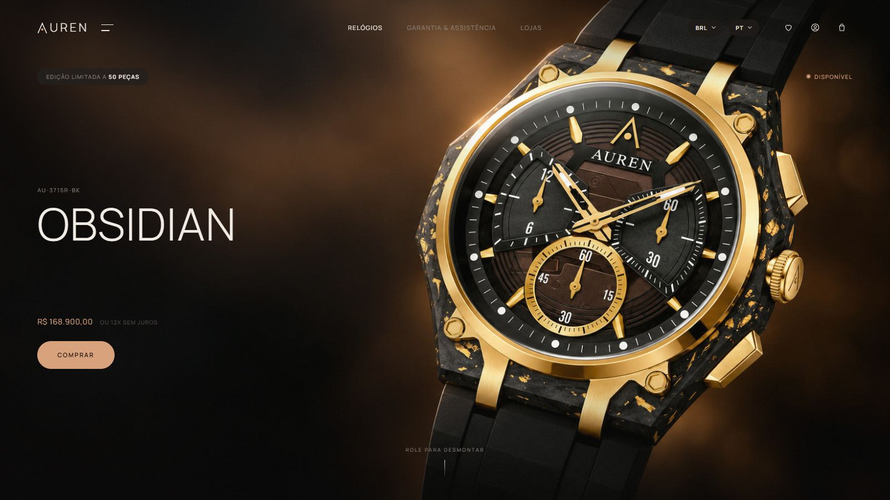

# AUREN · Obsidian

[](https://auren-obsidian.vercel.app)

[](https://auren-obsidian.vercel.app)

Landing page de um relógio que não existe. AUREN é uma relojoaria de luxo que inventei para fazer uma página de lançamento de produto no nível das grandes marcas: o relógio se desmonta peça por peça enquanto você rola, cada componente ganha uma explicação, e depois vêm detalhes, especificações, coleção e compra.

Não precisa baixar nada para ver: o site está publicado em **[auren-obsidian.vercel.app](https://auren-obsidian.vercel.app)**.

## O relógio

O OBSIDIAN é um cronógrafo de 44 mm com caixa em carbono forjado salpicado de flocos de ouro, luneta em ouro 18k e edição limitada a 50 peças numeradas. Como o carbono é prensado com o ouro, o desenho da superfície nunca se repete, e cada caixa é única.

Marca, modelos, especificações, preços e boutiques são inventados.

## A página

A página foi pensada como a apresentação de um produto: cada rolagem revela algo novo, com animações suaves que acompanham o ritmo de quem está lendo.

- **O relógio se desmonta com a rolagem.** O hero é o primeiro quadro de um vídeo que avança e volta conforme você rola. Cada peça que se solta ganha uma anotação presa a ela por uma linha que a acompanha, e a câmera recua aos poucos até o relógio inteiro aparecer aberto.
- **Rolagem com inércia.** A página desliza e desacelera suavemente, com a mesma sensação em monitores de 60 Hz ou 144 Hz.
- **Entradas e transições.** Textos e imagens surgem conforme entram na tela, a foto da seção O relógio tem efeito de profundidade e o hero reage levemente ao movimento do mouse.
- **Navbar.** No topo ela se mistura ao hero; ao descer ganha fundo, encolhe e mostra os links das seções, sempre com idioma, moeda e sacola à mão.
- **Cinco idiomas e quatro moedas.** Português, inglês, espanhol, francês e japonês, com preços em BRL, USD, EUR ou JPY. A escolha fica salva no navegador.
- **Sacola.** Abre embaixo do ícone, guarda a pulseira e a gravação escolhidas, soma os valores e respeita o limite de três peças por cliente. A finalização da compra não faz parte do projeto, e a página avisa isso.
- **Vídeo de detalhes.** Um filme de 30 segundos com macros do relógio toca quando entra na tela, com capítulos clicáveis.

No celular, a câmera acompanha a peça da vez e só a anotação atual aparece. Quem usa o sistema com animações reduzidas recebe a página sem movimento.

## Stack

HTML, CSS e JavaScript, sem framework, sem dependências e sem build. Os scripts são clássicos, e não ES modules, para a página abrir também direto do disco. Cada comportamento fica num arquivo em `js/` e o CSS tem um arquivo por área da página.

As imagens do relógio, da coleção e os dois vídeos foram gerados com IA. O vídeo da desmontagem foi convertido em frames WebP para a rolagem ficar suave nos dois sentidos.

## Rodando localmente

Baixe o projeto pelo botão **Code → Download ZIP** aqui no GitHub (ou clone o repositório), extraia a pasta e abra o `index.html` no navegador. Como a página não depende de build nem de servidor, ela funciona assim mesmo, direto do disco.

```bash
git clone https://github.com/RobertoDev3/auren.git
```

Se for mexer no código, vale abrir a pasta no VS Code e usar a extensão [Live Server](https://marketplace.visualstudio.com/items?itemName=ritwickdey.LiveServer): ela sobe um servidor local e recarrega a página sempre que você salva um arquivo.

## Estrutura

```
index.html
css/
  tokens.css       cores, fontes e medidas
  base.css         reset e animação de entrada
  topbar.css       navbar, seletores de idioma e moeda
  header.css       hero
  explode.css      palco do relógio desmontando e anotações
  sections.css     seções depois do relógio
  overlays.css     sacola, avisos e transição dos atalhos
  footer.css
js/
  locales/         um arquivo de textos por idioma
  i18n.js          troca de idioma e conversão de preços
  frame-sequence.js  carrega e desenha os frames no canvas
  explode.js       rolagem → frame, câmera e anotações
  smooth-scroll.js rolagem com inércia
  film-reel.js     vídeo da seção Detalhes
  bag.js           sacola
  site.js          navbar, atalhos, avisos e página de compra
  main.js
assets/
  frames/          193 frames do relógio desmontando
  images/          hero, coleção e fotos das seções
  video/           vídeo da seção Detalhes
  brand/           símbolo da AUREN
```

## Direitos

© 2026 Roberto. Todos os direitos reservados.

Não é permitido usar este projeto, no todo ou em parte, para fins comerciais. Isso inclui o código, as imagens, os vídeos e os textos.

---

Feito por [Roberto](https://github.com/RobertoDev3).
